<p align="center">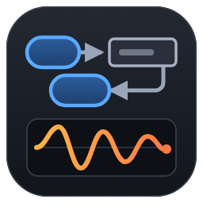</p>

# ROS 2 Visualiser for Visual Studio Code

rqt-style ROS 2 introspection and visualisation tools inside Visual Studio Code.


Author: Myeongjin Lee (menggu1234@naver.com)

## Overview

ROS 2 Visualiser brings the everyday rqt tools into VS Code panels, next to your code. It starts one small Python process that uses the `rclpy` of your ROS 2 installation, so every message, service and parameter type of your workspace works without code generation. ROS 2 must be installed on the machine that runs the extension.

What you can do:

- See the node graph, with nodes, topics and the connections between them.
- Monitor every topic's rate, bandwidth, message size and publishers/subscribers, and read live messages.
- View camera images, depth images, occupancy grids, point clouds and laser scans.
- Plot any numeric field of any topic.
- Call services, publish messages, and read or change node parameters.
- Filter `/rosout` logs, inspect the TF tree, and view the robot model from a URDF or xacro file.

```
 VS Code panels (graph, topics, image, 3D, plot, URDF, ...)
        ▲  JSON + binary frames
        │
 extension host ──spawns──▶ python3 ros_backend.py (rclpy node "_vscode_ros_vis_<pid>")
                                  │  DDS (your ROS_DOMAIN_ID)
                                  ▼
                          ROS 2 nodes on the network
```

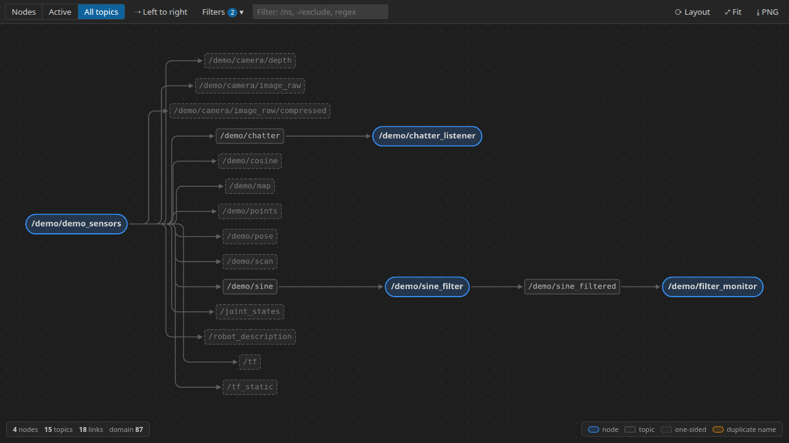

### Supports

| Platform | Status | Notes |
|---|---|---|
| Ubuntu 24.04, ROS 2 Jazzy, `rmw_fastrtps_cpp` |  | Development platform. Backend protocol, extension host and UI tests run here. |
| Other ROS 2 distributions (Humble, Kilted, Rolling) |  | Uses only public `rclpy` APIs. Not yet verified. |
| Other RMW implementations (Cyclone DDS, Zenoh) |  | The backend is RMW-agnostic. Select one with `rosVis.rmwImplementation`. |
| VS Code Remote (SSH, WSL, Dev Containers) |  | The extension runs on the remote host, so ROS 2 must be installed there. |
| Windows, macOS |  | Not in scope. Sourcing setup scripts assumes `bash`. |

## Contents

- [Overview](#overview)
  - [Supports](#supports)
- [Quick Start](#quick-start)
- [1. Package Layout](#1-package-layout)
- [2. Installation](#2-installation)
  - [2.1 Requirements](#21-requirements)
  - [2.2 Install the extension](#22-install-the-extension)
  - [2.3 Check](#23-check)
  - [2.4 Uninstall](#24-uninstall)
- [3. Usage](#3-usage)
  - [3.1 Sidebar and status bar](#31-sidebar-and-status-bar)
  - [3.2 Node Graph](#32-node-graph)
  - [3.3 Topic Monitor](#33-topic-monitor)
  - [3.4 Image View](#34-image-view)
  - [3.5 3D / Point Cloud](#35-3d--point-cloud)
  - [3.6 Plot](#36-plot)
  - [3.7 URDF Viewer](#37-urdf-viewer)
  - [3.8 TF Tree](#38-tf-tree)
  - [3.9 Console](#39-console)
  - [3.10 Service Caller, Publisher, Parameters](#310-service-caller-publisher-parameters)
  - [3.11 Demo data](#311-demo-data)
- [4. Configuration](#4-configuration)
  - [4.1 Settings](#41-settings)
  - [4.2 How the backend is started](#42-how-the-backend-is-started)
- [5. Safety](#5-safety)
- [6. Files and Data](#6-files-and-data)
- [7. Troubleshooting](#7-troubleshooting)
- [8. Performance](#8-performance)
- [9. Known Limitations](#9-known-limitations)
- [10. License](#10-license)
- [11. Third-Party Notices](#11-third-party-notices)

## Quick Start

```bash
$ source /opt/ros/jazzy/setup.bash
$ ros2 node list                                   # nodes you expect to see
$ code --install-extension mjlee111.ros2-visualiser
$ code ~/my_ws                                     # a workspace with install/setup.bash, or any folder
```

Click the **ROS 2** icon in the Activity Bar and pick a tool. The status bar shows `ROS jazzy · D<domain> · <n> nodes · <m> topics` once the backend is connected. If it shows **ROS backend error**, see §7.

## 1. Package Layout

The extension is published on the Visual Studio Marketplace as `mjlee111.ros2-visualiser`. Each version is one package file, `ros2-visualiser-<version>.vsix`. It contains:

```
ros2-visualiser-<version>.vsix
└── extension/
    ├── package.json               manifest: commands, views, settings
    ├── README.md                  this document
    ├── CHANGELOG.md               release history
    ├── LICENSE.txt                MIT license (§10)
    ├── THIRD_PARTY_NOTICES.md     licenses of bundled libraries (§11)
    ├── dist/extension.js          extension host code
    ├── dist/webview/*.js, *.css   panel UIs, include three.js and cytoscape (§11)
    ├── python/ros_backend.py      rclpy backend, started by the extension
    ├── python/demo_sensors.py     demo publisher (§3.11)
    ├── python/demo_robot.py       demo robot model used by demo_sensors.py
    └── media/                     icons
```

The extension has no runtime dependencies other than VS Code and a ROS 2 installation.

## 2. Installation

### 2.1 Requirements

| Item | Requirement |
|---|---|
| VS Code | 1.85 or later |
| ROS 2 | Jazzy (tested), with `rclpy` |
| Python | The interpreter ROS 2 was built for (`/usr/bin/python3` for apt installs), with `numpy` |
| OpenCV (optional) | `python3-opencv`: faster JPEG streaming, Bayer/YUV images, `compressedDepth` |
| xacro (optional) | `ros-jazzy-xacro`: opening `.xacro` files in the URDF Viewer |
| GPU | WebGL in VS Code, for the 3D / Point Cloud view and the URDF Viewer |
| Network | DDS traffic on your ROS domain only. No internet access. |

### 2.2 Install the extension

Open the Extensions view, search for **ROS 2 Visualiser** (publisher `mjlee111`), and click **Install**. Or, from a terminal:

```bash
$ code --install-extension mjlee111.ros2-visualiser
```

VS Code updates the extension automatically when a new version is published.

**Offline install from a `.vsix` file**

```bash
$ code --install-extension ros2-visualiser-<version>.vsix
```

Alternatively, open the Extensions view, choose **...** > **Install from VSIX...**, and select the file. To reinstall a build with the same version number, add `--force`.

### 2.3 Check

The status bar shows the connection:

```
ROS jazzy · D0 · 7 nodes · 23 topics
```

Run **ROS: Show Backend Log** from the Command Palette. The **ROS 2 Visualiser** output channel logs the backend start:

```
starting backend: /usr/bin/python3
[ros_backend] started {"distro": "jazzy", "rmw": "rmw_fastrtps_cpp", "domainId": 0, ...}
```

### 2.4 Uninstall

```bash
$ code --uninstall-extension mjlee111.ros2-visualiser
```

The extension stores nothing outside VS Code's own panel state (§6).

## 3. Usage

### 3.1 Sidebar and status bar

The **ROS 2** view in the Activity Bar has two sections:

- **Tools** opens each panel.
- **Graph Explorer** lists nodes (with their publishers, subscribers, services, clients and actions), topics, services and actions. Right-click an item to monitor, plot, publish, call, open its parameters, view an image or point cloud topic, or show the interface definition. Nodes that share an exact name are marked with a warning.

Click the ROS item in the status bar for a quick list of tools. All commands are in the Command Palette under the **ROS** category.

### 3.2 Node Graph

The rqt_graph equivalent.

- **Nodes**, **Active** (topics with both a publisher and a subscriber) and **All topics** views. Topics that only have publishers or only subscribers are drawn dashed.
- **Filters** hide debug topics, TF, dead sinks, topics without publishers, and hidden nodes (`_` prefix). They can also group nodes by namespace and show the rate of every topic.
- The filter box takes comma-separated names or regular expressions. Prefix a term with `-` to exclude it.
- Click a node or topic for details. Double-click a topic to open it in the Topic Monitor, or a node to open its parameters. **PNG** saves the graph as an image.

### 3.3 Topic Monitor

The rqt_topic equivalent.

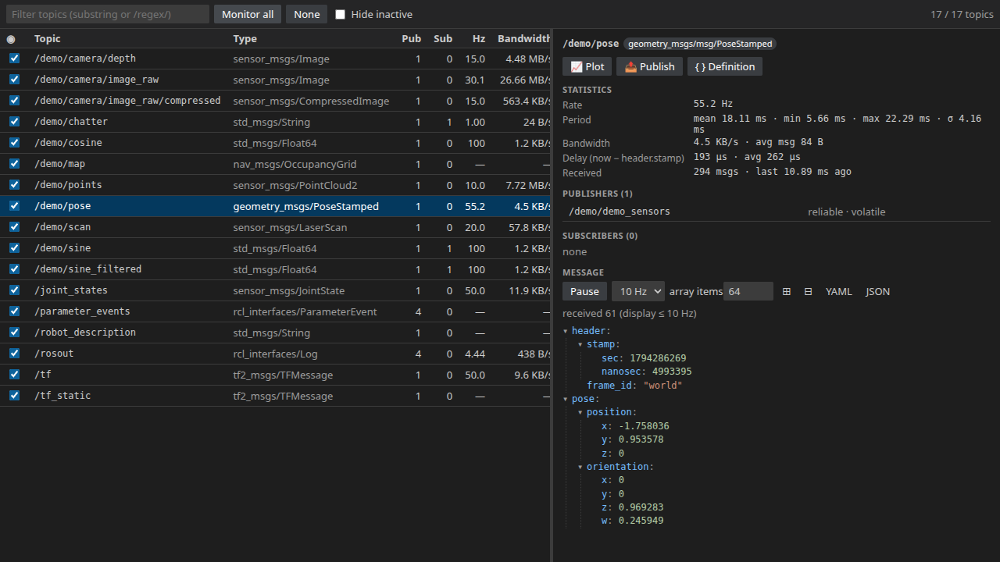

- Every topic with its type, publisher and subscriber count, rate, bandwidth and message size. Tick a topic, or **Monitor all**, to measure it.
- Select a topic to see:
  - the period (mean, min, max, standard deviation)
  - the delay against `header.stamp`
  - the publishers and subscribers, with their QoS
  - the live message tree
- Pause the message tree, copy the message as YAML or JSON, or click 📈 next to a numeric field to plot it.

Rate and bandwidth are measured on serialized messages, so watching a 30 MB/s camera topic costs no deserialization.

### 3.4 Image View

The rqt_image_view equivalent.

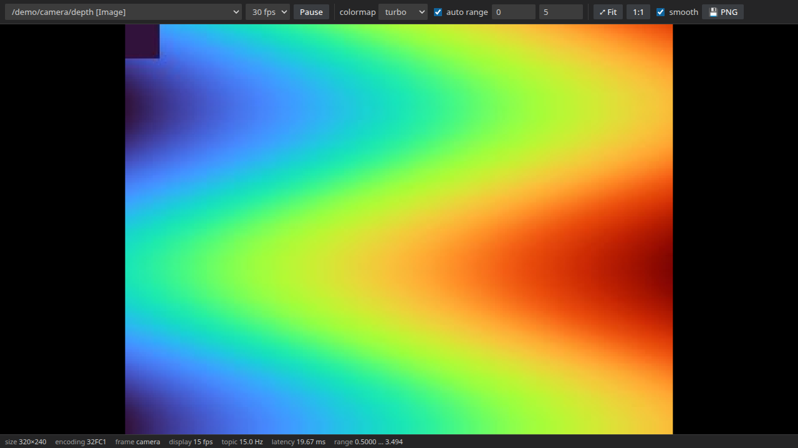

- `sensor_msgs/Image`: `rgb8`, `bgr8`, `rgba8`, `bgra8`, 16-bit colour, `mono8`, `mono16`, `8UC1/3/4`, `8SC1`, `16UC1`, `16SC1`, `32SC1`, `32FC1`, `64FC1`, Bayer and YUV 4:2:2.
- `sensor_msgs/CompressedImage` (JPEG, PNG, `compressedDepth`) and `nav_msgs/OccupancyGrid`.
- Depth and float images use a colormap with automatic or manual range.
- Zoom with the mouse wheel, pan by dragging, **1:1** for actual pixels. Hover for pixel coordinates and values. **PNG** saves the current frame.

### 3.5 3D / Point Cloud

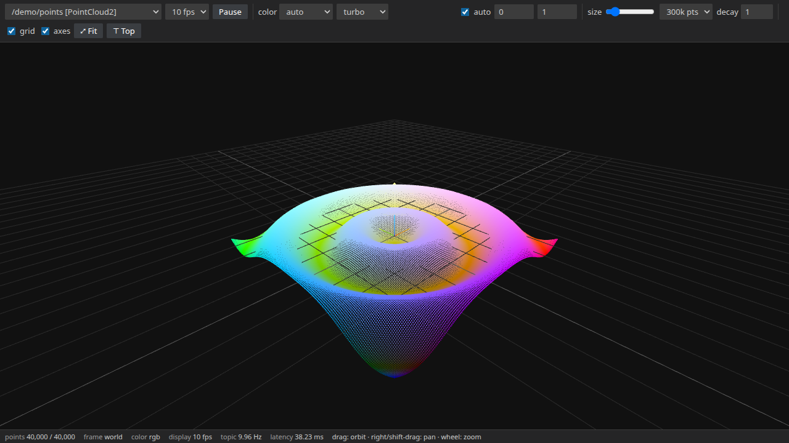

- `sensor_msgs/PointCloud2` with any field layout and `sensor_msgs/LaserScan`.
- Colour by packed RGB/RGBA or by any field (intensity, z, range, ...), with selectable colormaps.
- Point size, a point budget (the backend decimates large clouds), and **decay** to accumulate several scans.
- Drag to orbit, right-drag or shift-drag to pan, use the wheel to zoom. **Fit** and **Top** reset the view. ROS conventions apply: Z is up, the grid is the XY plane.

### 3.6 Plot

The rqt_plot equivalent.

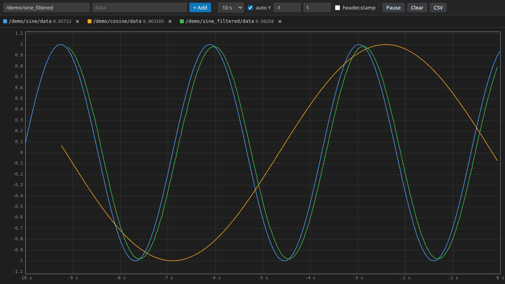

- Add `topic` + `field` pairs. Field names autocomplete from the message definition (`data`, `pose.position.x`, `ranges[3]`, ...).
- Time axis from receive time or from `header.stamp`. Window from 5 s to 300 s, automatic or fixed Y range.
- Hover for values, click a legend item to hide it, **CSV** exports the visible data.

### 3.7 URDF Viewer

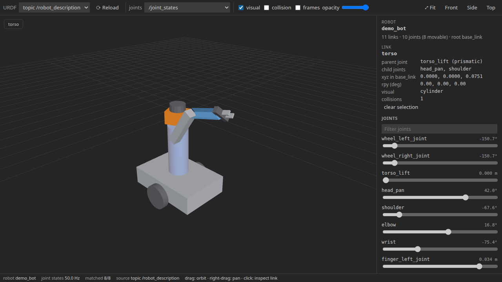

The robot model can come from three sources:

- **Live robot**: the `/robot_description` topic, or the `robot_description` parameter of `robot_state_publisher`.
- **File**: right-click a `.urdf` or `.xacro` file in the Explorer, or use the editor title button, and choose **Open in URDF Viewer**. Xacro files are expanded with the `xacro` executable. Saving any `.urdf`, `.xacro`, `.yaml` or `.xml` file reloads the view, so you can edit a URDF and see the result.

Display and joints:

- Joints follow any `sensor_msgs/JointState` topic. The status bar shows how many joint names matched the URDF and lists the names that did not.
- With **sliders** as the joint source, joints are moved locally and nothing is published.
- Meshes (STL, Collada, OBJ, glTF binary) are resolved through `package://`, `file://` or paths relative to the URDF file.
- Mimic joints, collision geometry, link frames and opacity are supported. Click a link to see its parent joint and its pose in the root frame.

### 3.8 TF Tree

The rqt_tf_tree equivalent.

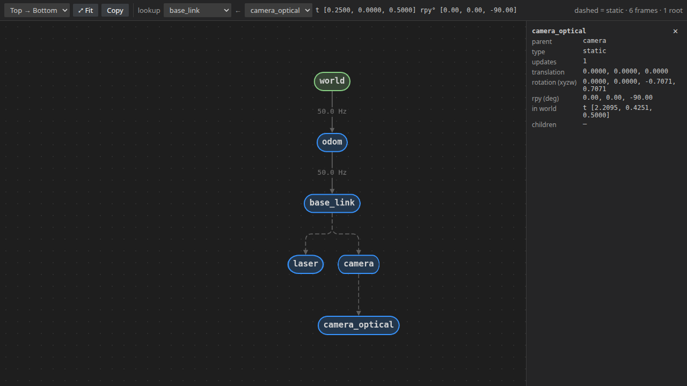

- `/tf` and `/tf_static` as a tree, with the update rate of each dynamic transform. Static transforms are dashed.
- Stale transforms are highlighted, and more than one root is reported.
- **Lookup** shows the transform between any two frames, like `tf2_echo`.

### 3.9 Console

The rqt_console equivalent.

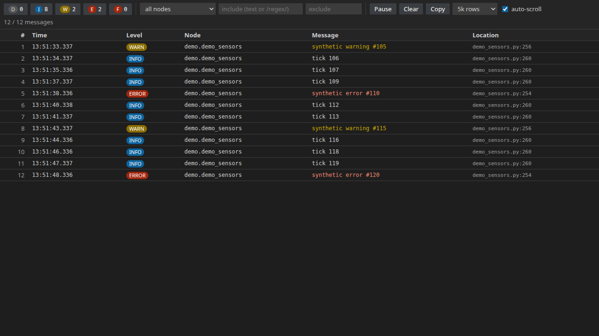

- `/rosout` with per-level toggles and counts, a node filter, and include/exclude text or `/regex/` filters.
- Click a row for details. Double-click it to open the source file at the logged line, when that file exists on this machine.

### 3.10 Service Caller, Publisher, Parameters

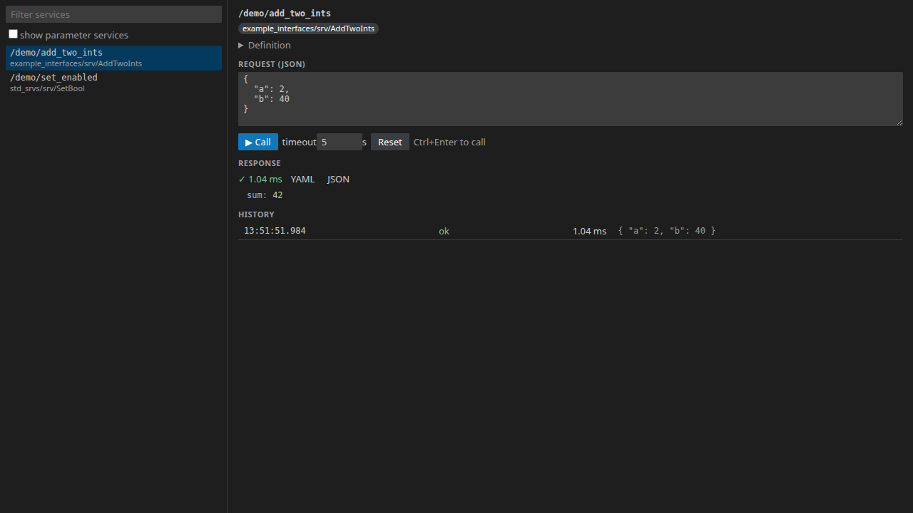

- **Service Caller**: pick a service, edit the request as JSON (prefilled from the type), call with a timeout, and inspect the response and the call history.
- **Publisher**: one or more publishers with a JSON message, a rate or **Send once**, automatic `header.stamp`, and QoS. Edit and **Apply** while publishing. See §5.
- **Parameters**: list, read and set the parameters of any node. Declared ranges become sliders, and read-only parameters are locked. **Copy YAML** gives a `ros2 param dump`-style file.

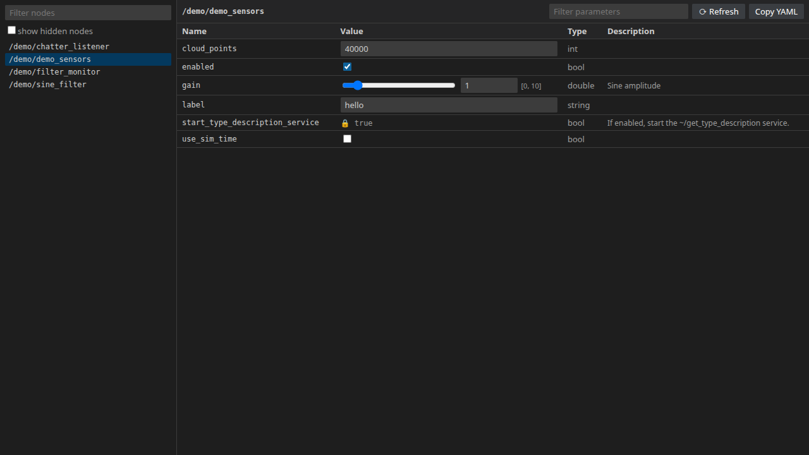

### 3.11 Demo data

The extension ships a demo publisher. It publishes:

- camera, depth and compressed images
- a point cloud, a laser scan and an occupancy grid
- scalars, a pose, TF and logs
- a small robot with meshes (`/robot_description`, `/joint_states`)

It also offers services and parameters. Run it in an isolated domain:

```bash
$ export ROS_DOMAIN_ID=87 ROS_AUTOMATIC_DISCOVERY_RANGE=LOCALHOST
$ /usr/bin/python3 ~/.vscode/extensions/mjlee111.ros2-visualiser-<version>/python/demo_sensors.py
```

Set `rosVis.domainId` to `87`, or start VS Code from the same shell, to see it.

## 4. Configuration

### 4.1 Settings

Open **File > Preferences > Settings** and search for `rosVis`. Changing any of these restarts the backend.

| Setting | Default | Description |
|---|---|---|
| `rosVis.pythonPath` | `""` | Python interpreter for the backend. Empty uses `/usr/bin/python3` on Linux if present, else `python3`. Conda and venv interpreters usually cannot load the ROS build of `rclpy`. |
| `rosVis.setupScripts` | `[]` | Scripts sourced in order before the backend starts, for example `/opt/ros/jazzy/setup.bash` and `/home/me/ws/install/setup.bash`. `${workspaceFolder}` and `~` are expanded. |
| `rosVis.autoSourceWorkspace` | `true` | Also source `<workspace folder>/install/setup.bash` when it exists. Needed for custom message types and `package://` meshes. |
| `rosVis.domainId` | `null` | Override `ROS_DOMAIN_ID` for the backend. `null` inherits VS Code's environment. |
| `rosVis.rmwImplementation` | `""` | Override `RMW_IMPLEMENTATION`, for example `rmw_cyclonedds_cpp`. |
| `rosVis.graphPollInterval` | `1.0` | Seconds between ROS graph polls (minimum 0.2). |
| `rosVis.image.jpegQuality` | `85` | JPEG quality (10–100) used to stream raw images to the Image View. |

Panel options, such as graph filters, plot series, publisher definitions and the URDF source, are saved per panel and restored when VS Code restarts.

### 4.2 How the backend is started

1. Interpreter: `rosVis.pythonPath`, or `/usr/bin/python3`, or `python3`.
2. Environment: if `rosVis.setupScripts` is set, those scripts are sourced with `bash`. Otherwise VS Code's own environment is used. If ROS is not sourced there, for example when VS Code was started from the desktop, `/opt/ros/<distro>/setup.bash` is found automatically, preferring `$ROS_DISTRO`.
3. Workspace overlay: with `rosVis.autoSourceWorkspace`, `install/setup.bash` of each open workspace folder is sourced as well.
4. `rosVis.domainId` and `rosVis.rmwImplementation` are applied on top.

If the backend crashes, it is restarted automatically, up to four times a minute. **ROS: Restart ROS Backend** restarts it by hand.

## 5. Safety

**Publisher**, **Service Caller** and **Parameters** act on the live ROS domain shown in the status bar (`D<id>`), exactly like their rqt equivalents. Messages, service calls and parameter changes reach every node on that domain, including real hardware.

- The Publisher panel shows the active domain and RMW, and only publishes after an explicit **Start** or **Send once**.
- A panel's publishers stop when the panel closes, on **Stop all**, and when the backend stops. They are never restarted automatically.
- The URDF Viewer's sliders never publish joint states.
- Panels can only run this extension's own `rosVis.*` commands.

For experiments, use an isolated domain (`rosVis.domainId`) or `ROS_AUTOMATIC_DISCOVERY_RANGE=LOCALHOST`.

## 6. Files and Data

- The extension writes files only where you choose in a save dialog (graph PNG, image PNG, plot CSV).
- The backend reads URDF/xacro files you open, and mesh and texture files (`.stl`, `.dae`, `.obj`, `.glb`, `.gltf`, `.ply`, image formats) referenced by a URDF. It refuses to serve other file types to the panels.
- The backend creates one ROS node, `_vscode_ros_vis_<pid>`, which is hidden in the graph views. It subscribes only to the topics shown in open panels.
- The extension makes no internet requests.

## 7. Troubleshooting

Messages appear in a notification, in the panel, or in the **ROS 2 Visualiser** output channel (**ROS: Show Backend Log**).

| Message | Cause | Fix |
|---|---|---|
| `The backend cannot import rclpy. Set "rosVis.pythonPath" ...` | The interpreter is not the one ROS was built for (often a Conda or venv Python), or ROS is not sourced | Set `rosVis.pythonPath` to `/usr/bin/python3`, or set `rosVis.setupScripts` |
| `setup script not found: <path>` | A path in `rosVis.setupScripts` does not exist | Fix the path |
| Status bar shows `0 nodes` | Different `ROS_DOMAIN_ID` or discovery range than your nodes | Compare with `ros2 node list` in a terminal. Set `rosVis.domainId` |
| `cannot load type <type>: ... (source your workspace?)` | A custom message package is not on the backend's path | Open the workspace folder, or add its `install/setup.bash` to `rosVis.setupScripts` |
| `unsupported encoding "<enc>"` | Image encoding not in the list in §3.4 | Republish in a supported encoding |
| `Bayer images require OpenCV` / `YUV images require OpenCV` | OpenCV is missing | `sudo apt install python3-opencv` |
| `xacro executable not found` | xacro is not installed | `sudo apt install ros-jazzy-xacro` |
| URDF side panel: `<n> mesh(es) failed to load` | The package of a `package://` mesh is not sourced, or the file is missing | Source the workspace that contains the description package. The panel lists the failing file names |
| URDF status bar `matched 0/<n>` | Wrong JointState topic, or joint names differ from the URDF | Pick another topic in **joints**. The status bar lists names that are not in the URDF |
| `parameter services of <node> not available` | The node does not offer parameter services, or does not respond | Check `ros2 param list <node>` |
| `service <name> not available` | The service server is not running | Check `ros2 service list` |
| `×<n>` on a node / warning icon in Graph Explorer | Several nodes share the exact same name | Usually stale processes or a node launched twice. Their endpoints are merged |
| `backend crashed repeatedly; not restarting automatically` | The backend failed four times within a minute | Read the log, fix the cause, then run **ROS: Restart ROS Backend** |

## 8. Performance

Measured on Ubuntu 24.04, ROS 2 Jazzy, AMD Ryzen 9 9900X, with the demo publisher. Panels ran in Chrome with software WebGL through the development harness, not inside VS Code.

| Data | Rate published | Result |
|---|---|---|
| `Image` 640 × 480 `rgb8` (JPEG-streamed) | 30 Hz | 25–28 frames/s displayed |
| `Image` 320 × 240 `32FC1` depth, colormapped | 15 Hz | 15 frames/s displayed |
| `PointCloud2`, 40,000 points, xyz + intensity + rgb | 10 Hz | 9–10 frames/s displayed |
| 3 plot series | 100 Hz each | every sample plotted |
| Topic Monitor, all 17 demo topics measured, including 27 MB/s of raw images | — | rates match the publishers |

Image and point cloud panels keep at most one frame in flight, so a slow or hidden panel never builds up a backlog.

## 9. Known Limitations

- Actions are listed, but goals cannot be sent. Bag recording and playback (rqt_bag) are not included.
- The 3D view shows one topic per panel, in that topic's frame. It does not apply TF and does not draw markers.
- The URDF Viewer places links from joint states only (no TF mode) and does not load textures.
- Plot fields address single values. Whole arrays cannot be plotted.
- Other ROS 2 distributions, other RMW implementations and VS Code Remote have not been tested (see Supports).

## 10. License

Copyright (c) 2026 Myeongjin Lee.

Released under the MIT License. The full text is in [LICENSE](LICENSE). You may use, copy, modify and redistribute the software, provided the copyright and license notices, including those in §11, stay in place. The software is provided "as is", without warranty of any kind.

ROS and ROS 2 are trademarks of Open Robotics. This extension is not affiliated with or endorsed by Open Robotics or the ROS project.

## 11. Third-Party Notices

`dist/webview/*.js` include the following open-source components, all under the MIT License. The full license texts are in [THIRD_PARTY_NOTICES.md](THIRD_PARTY_NOTICES.md).

| Component | License |
|---|---|
| [three.js](https://threejs.org) | MIT, © three.js authors |
| [Cytoscape.js](https://js.cytoscape.org) | MIT, © The Cytoscape Consortium |
| [cytoscape-dagre](https://github.com/cytoscape/cytoscape.js-dagre) | MIT, © The Cytoscape Consortium |
| [dagre](https://github.com/dagrejs/dagre) | MIT, © Chris Pettitt |
| [graphlib](https://github.com/dagrejs/graphlib) | MIT, © Chris Pettitt |
| [lodash](https://lodash.com) | MIT, © OpenJS Foundation and other contributors |
